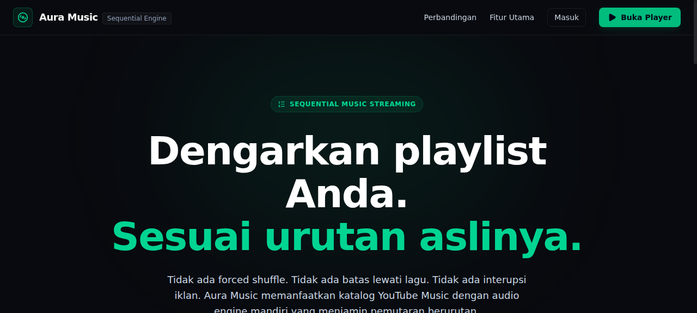
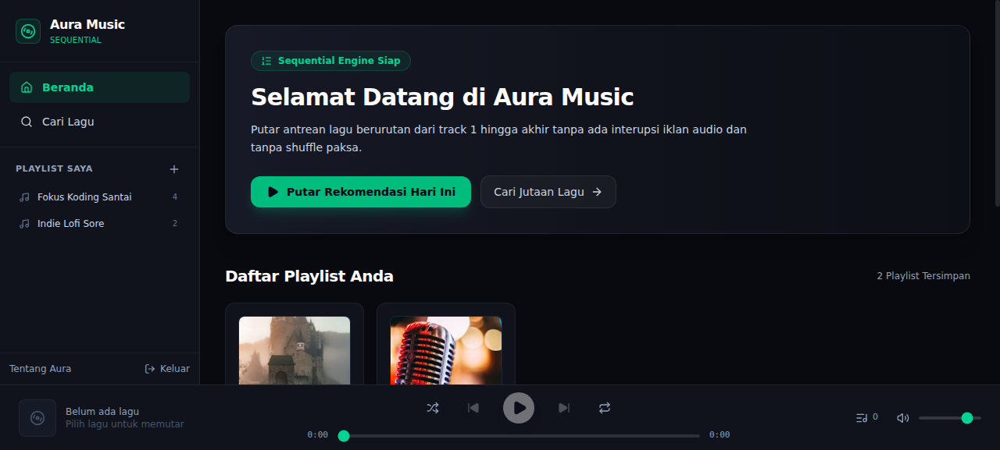
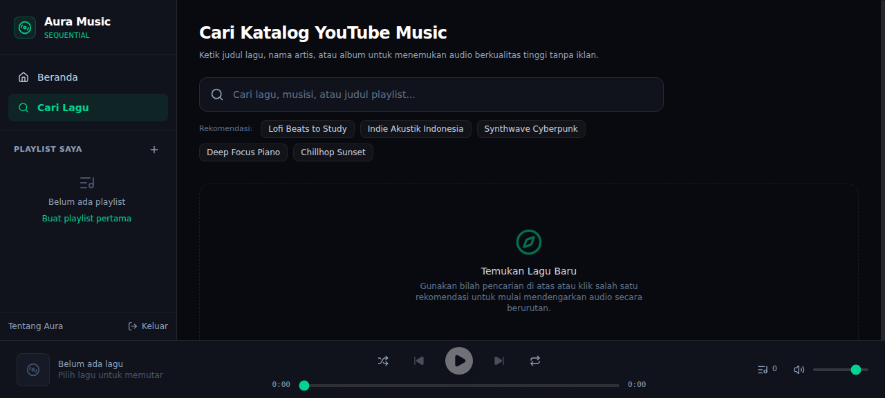

# fysic

> **The Unshuffled Music Experience.**
> Personal music streaming web application and PWA with guaranteed sequential playback, YouTube Music resolver engine, Media Session lockscreen controls, and Drizzle ORM playlist persistence.

---

## Background & Problem Statement

Spotify Free on mobile devices imposes severe restrictions on listeners:
1. **Forced Shuffle:** Playlists cannot be played in their intended track order (1, 2, 3...); users are forced into shuffle mode.
2. **Skip Limits:** Users are capped at 6 skips per hour.
3. **Audio Ad Interruption:** Frequent audio advertisements disrupt focused listening.
4. **Developer Restrictions:** The official Spotify Web Playback SDK strictly blocks free tier accounts with `403 Forbidden: Premium required`, preventing developers from building customized playback interfaces without requiring paid subscriptions.

**fysic** solves this problem by decoupling music discovery from proprietary playback SDKs, leveraging a YouTube Music scraper backend and an independent HTML5 audio engine.

---

## Core Features

- **100% Sequential Playback Engine:** Tracks in a playlist transition automatically and gaplessly to the next track upon `audio.onended`, without forced shuffle.
- **Manual Playback Modes:** True manual Shuffle toggle and Repeat cycle (`off`, `all`, `one`).
- **YouTube Music Resolver:** Live search and audio stream extraction using `youtubei.js` (Innertube) with curated fallback for high availability.
- **Media Session Lockscreen API:** Background playback with native lockscreen metadata (title, artist, album, cover art) and action controls (`play`, `pause`, `nexttrack`, `previoustrack`, `seekto`).
- **Drizzle ORM Playlist Persistence:** Relational database schema with playlist creation, song addition, track reordering (`sort_order`), and deletion.
- **Progressive Web App (PWA):** Installable on Android, iOS, and desktop browsers via standalone web manifest.
- **Anti-Slop Modern UI:** Crafted dark aesthetic using Deep Obsidian (`#090a0f`), Surface Card (`#161926`), and Vibrant Emerald (`#10b981`), meeting WCAG AA contrast standards with semantic Lucide SVG icons.
- **Keyboard Shortcuts:** `Space` for Play/Pause toggle, `ArrowRight` to seek forward 5s, `ArrowLeft` to seek backward 5s.

---

## Architecture Overview

```
                      +---------------------------------------+
                      |       fysic Frontend (Next.js 15)     |
                      |  - Landing Page: /                    |
                      |  - Web Player:   /app                 |
                      |  - Live Search:  /app/search          |
                      |  - Playlists:    /app/playlist/[id]   |
                      +-------------------+-------------------+
                                          |
                        +-----------------+-----------------+
                        |                                   |
                        v                                   v
             +--------------------+              +--------------------+
             | Audio Engine       |              | Next.js API Routes |
             | (lib/player-ctx)   |              | - /api/search      |
             | - Sequential Queue |              | - /api/stream      |
             | - Media Session    |              | - /api/playlists   |
             | - HTML5 Audio      |              | - /api/auth/*      |
             +--------------------+              +---------+----------+
                                                           |
                                      +--------------------+--------------------+
                                      |                                         |
                                      v                                         v
                         +--------------------------+              +--------------------------+
                         | YouTube Music Resolver   |              | Database Persistence     |
                         | (youtubei.js Innertube)  |              | (Drizzle ORM)            |
                         +--------------------------+              +--------------------------+
```

---

## Tech Stack

| Layer | Technology |
|---|---|
| **Framework** | Next.js 15.3.6 (App Router) |
| **UI Library** | React 19, Tailwind CSS v4, Lucide React |
| **Language** | TypeScript (Strict mode) |
| **Audio Scraper** | YouTubei.js (Innertube v18) |
| **ORM & Database** | Drizzle ORM, SQLite (`better-sqlite3`), PostgreSQL-ready |
| **PWA** | Web App Manifest, Standalone Mode, Media Session API |

---

## API Endpoints

### 1. Catalog & Streaming
- `GET /api/search?q={query}`: Search YouTube Music catalog for songs. Returns cleaned track list (id, title, artist, album, thumbnail, duration).
- `GET /api/stream?id={youtubeId}`: Extract and return direct audio stream URL with fallback resolution.

### 2. Playlist Management
- `GET /api/playlists`: Fetch all user playlists with track counts.
- `POST /api/playlists`: Create a new custom playlist (`title`, `description`).
- `GET /api/playlists/:id`: Get playlist details and sorted tracks (`sortOrder ASC`).
- `POST /api/playlists/:id`: Add a track to the playlist.
- `PATCH /api/playlists/:id`: Update playlist metadata or reorder tracks (`trackOrders: [{ id, sortOrder }]`).
- `DELETE /api/playlists/:id`: Delete a playlist and its track relations.
- `DELETE /api/playlists/:id/tracks/:trackId`: Remove an individual track from a playlist.

### 3. Authentication Mockup
- `POST /api/auth/login`: Authenticate and issue `aura_session` cookie.
- `POST /api/auth/register`: Register new user profile.
- `GET /api/auth/me`: Check current session.
- `POST /api/auth/me`: Logout and clear session cookie.

---

## Getting Started

### Prerequisites
- Node.js >= 20 (tested on v26)
- npm >= 10

### Installation
```bash
# Clone the repository
git clone https://github.com/janfdev/fysic.git
cd fysic

# Install dependencies
npm install

# Run database tests & self-checks
npm test

# Build for production
npm run build

# Start production server
npm start
```

Open [http://localhost:3000](http://localhost:3000) in your browser.

---

## Verification & Test Results

```bash
$ npm test
Running self-check assertions...
* Curated tracks validation passed
* Sequential queue state machine logic passed
* Database persistence & operations passed
ALL ASSERTION CHECKS PASSED!

$ npx tsc --noEmit
# Exit code 0 (zero errors)

$ npm run build
# 14/14 routes compiled and generated successfully
```

---

## Screenshots

### Landing Page & Value Proposition


### Web Player Interface & Sequential Queue


### Live YouTube Music Catalog Search


---

## License

MIT (C) 2026 janfdev.
